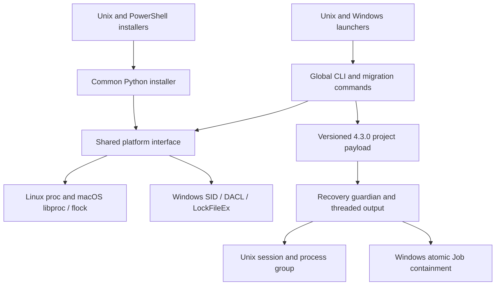

# V4.3.0 implementation and verification results

Status: **CROSS_PLATFORM_IMPLEMENTATION_SUCCESS**, limited to implementation and
applicable local automated regression tests. This is an **unpublished CANDIDATE**,
not a fully verified cross-platform release. No remote release, commit, push,
release promotion, real-account installation or client-project modification was
performed. The 4.1.0 payload and all legacy fixtures remain byte-for-byte unchanged.

Date: 2026-11-24 (Asia/Dhaka). See [machine-readable evidence](CROSS-PLATFORM-RESULTS.json).
The report intentionally uses LOCAL_AUTOMATED_PASS, not the generic PASS status
accepted by the release promotion command.

## Implementation and architecture

The engine now uses a shared platform layer for native locks, directories,
permissions, ownership, reparse-point checks, executable resolution and process
identity. A Windows adapter implements SID/DACL security, private directory
creation and LockFileEx. The 4.3.0 payload has sealed copies of these modules;
4.1.0 was not edited. Recovery uses libproc on macOS, the existing Linux process
model, and native Windows Job membership assigned during CreateProcessW.



Install/update/uninstall and signed distribution retain existing interfaces.
Added native wrappers, private staging, filesystem capability detection, native
launcher handling, UTF-8 reads, LF checkout rules, Windows-safe archive names and
case-alias rejection. Project backup/rollback captures Windows security
descriptors. Runtime writes now use unique atomic temporary files; inherited
legacy predictable-temp symlink exposure is fixed only in the new payload.
Profiles retain digest-bound approval, with Composer, Docker Compose validation,
PowerShell and Windows-aware Python/PHP command detection added.

The audit and ordered checklist are in [CROSS-PLATFORM-AUDIT.md](CROSS-PLATFORM-AUDIT.md).
Installation commands for Ubuntu/Debian, WSL2, both Mac architectures, Windows
PowerShell/CMD/Git Bash, team upgrades, rollback, storage and limitations are in
[CROSS-PLATFORM.md](CROSS-PLATFORM.md).

## Regression evidence

Actual machine: macOS 27.2.1, ARM64; Python 3.9.6; Git 2.56.0;
OpenSSH 10.5p1. Codex CLI 0.171.0-alpha.13 is installed through the IDE extension.
Claude CLI and GitHub CLI were not found on PATH.

| Run | Actual result |
|---|---|
| Unmodified checkout baseline | 99 tests, 52 failures, no errors |
| Final comprehensive candidate suite | 139 tests, 133 passed, 6 Windows-only skips, no failures/errors; 108.366 seconds |
| Existing regression cases | All 99 passed with candidate selected for orchestrator runtime cases |
| New platform primitives | 14 cases: 11 passed, 3 Windows-only skips |
| New portable installation/distribution | 9 passed |
| New runtime | 12 cases: 11 passed, 1 Windows-only skip |
| New CLI lifecycle | 3 passed |
| New native Windows Job tests | 2 skipped on macOS |
| 4.1.0 and 4.3.0 payload checksum validation | Passed; 15 and 19 manifest entries respectively |
| Sealed platform-module copies | Identical to engine modules |
| Whitespace validation and immutable-payload diff | Passed |

Reproduce the candidate run:

```sh
ORCH_TEST_RELEASE=4.3.0 python3 -B -m unittest discover -s tests -v
```

The checkout contains 99 old tests, not the earlier described 85. Existing fixture
adjustments include copying the CLI's new shared library dependency, canonical
Mac temporary roots (preventing /var aliases from changing fixture IDs), isolated
Apple xcrun caches, disabled bytecode caches, and replacing the obsolete test that
required Darwin rejection. Test outcomes were not converted to unconditional
passes. Historical POSIX fixtures still run on Unix; native suites run on Windows.

The untouched 4.1.0 runtime remains Linux-specific and imports tomllib, which is
absent before Python 3.11. The candidate fixes that runtime issue. Passing the
candidate suite on Mac is not a claim that old 4.1.0 runtime suddenly supports Mac.

## Actual isolated Mac command execution

After the comprehensive run passed, a separate command sequence created a
disposable HOME, engine, launcher directory and fresh Git project with Unicode
and spaces. It ran the installed global launcher, then removed the installation.

| Requested check | Evidence / status |
|---|---|
| Global CLI installation and doctor | PASS in isolated per-user layout |
| Fresh Git initialization and project verify | PASS |
| Claude-only default | PASS task state inactive |
| Use Codex activation semantics | PASS direct Task State Manager start; natural-language Claude interpretation blocked |
| Read-only Codex delegation | PASS controlled mock in automated suite; authenticated live attempt blocked |
| Persistent exact session resume | PASS mock CREATE then same UUID RESUME; live unavailable |
| Task State Manager | PASS start, add task, pause |
| Process supervision | PASS approved harmless Make command; timeout/parent-death/error cleanup in automated suite |
| Context Monitor | PASS actual script execution |
| Completion Gate | PASS actual hook script returned block for unfinished task; live Claude Stop lifecycle blocked |
| Global status | PASS actual installed command |
| Backup and restore | PASS actual installed commands, post-restore integrity passed |
| Safe uninstall | PASS project then engine removal; launcher removed |
| Settings preservation | PASS isolated preexisting settings sentinel; real authentication/settings were not changed |

Twenty-one checks passed in this command sequence; three live/real-account checks
are recorded as blocked. Temporary installation cleanup completed. The supplied
verification report distinguishes real operating-system process execution from
mock agent behavior; no mock is presented as a live authenticated agent session.

## Linux, Windows and CI status

| Target | Current evidence |
|---|---|
| macOS ARM64 | Local automated suite and isolated CLI checks passed; live agents blocked |
| macOS Intel | CI configured, not executed |
| Ubuntu 20.04/24.04, Debian and compatible distributions | Existing harness retained; not executed here |
| Windows 10 / Windows 11 native | Native implementation and tests added; not executed |
| Windows PowerShell / CMD / Git Bash | Wrappers/launcher and shell contract implemented; not executed natively |
| WSL2 | Uses Linux path; no local WSL2 verification |

Docker is installed but sandbox access to its API socket was denied. No sandbox
escalation was attempted. The five-distribution container harness therefore has
no new PASS result. Native Windows and Intel Mac machines are unavailable here.

[CI configuration](../.github/workflows/cross-platform.yml) includes Ubuntu 24.04,
macOS 15 ARM64, macOS 15 Intel and Windows Server 2025, plus Python 3.8 floor and
five-distribution Linux harness jobs. It prints real runner architecture and
requires no agent secrets. CI was not triggered because pushing is prohibited.
Server 2025 is not evidence for Windows 10 or 11 client editions.

## Delegation, review and corrections

The requested dedicated CLI session was attempted with `codex exec --sandbox
read-only --cd <repository> --json ...`, without model/effort/speed overrides.
It failed before a session ID was created: Operation not permitted initializing
the in-process app-server, with read-only diagnostic database errors. No exact
CLI session ID exists to reuse. `resume --last` was never used.

Claude CLI was absent. The user explicitly authorized Codex-led architecture,
implementation and review. Built-in repository-scoped Codex agents `platform`,
`installer`, and `runtime` implemented separate areas and cross-reviewed them.
These are not substituted as evidence of a persistent Codex CLI session.

Corrections found through tests and independent Codex review included:

- Mac process identity and CPU monitoring; Python-before-3.11 preferences fallback.
- Atomic Windows Job assignment instead of a suspended-child assignment gap.
- Cleanup guard before monitor initialization, retained group identity, and
  lock retention while cleanup cannot be authoritatively confirmed.
- Windows guardian lock-path metadata and shared management lock through the
  caller's post-execution work.
- Private Windows directory creation, ACL backup/restoration, and reparse checks.
- Unique runtime atomic writes and protected log append opens.
- Mac path aliases and Apple interpreter-cache contamination of test snapshots.
- Archive case aliases and Windows reserved/ADS filenames.

Independent Claude review remains unavailable; the review evidence is Codex-only.

## Remaining limitations and blockers

1. All native Windows APIs, Windows shells, Intel Mac and required Linux targets
   still need actual passing runs. Windows Job/ACL/lock code is not verified by
   Mac compilation or skipped tests.
2. Actual Claude SessionStart/Stop, automatic continuation, authenticated Codex
   delegation, exact live resume and IDE propagation remain blocked. Claude is
   absent; nested Codex startup is denied. A real-account global installation is
   outside the current writable roots; only the isolated layout was installed.
3. Windows Claude hooks require Git Bash for CLAUDE_ENV_FILE; PowerShell-only hook
   environment propagation is not claimed. Candidate templates choose python on
   Windows when available, otherwise retain python3.
4. Batch arguments with quotes, percent, exclamation or control characters are
   rejected. Codex delegation needs native codex.exe when its TOML arguments
   cannot be represented safely through codex.cmd.
5. Windows launchers bind the Python executable used at install time. An upgrade
   using a different interpreter conservatively refuses a launcher mismatch.
6. The default project release remains immutable 4.1.0. Candidate use requires
   explicit `--release 4.3.0 --allow-unverified`; doctor warns when legacy runtime
   is selected outside Linux. Do not deploy the candidate into real client projects.
7. Windows inherited ACLs may be recalculated if parent policies change. Elevated
   foreign/Administrators-owned files fail closed. Private engine code uses a
   private ACL policy; arbitrary historical engine ACLs are not reconstructed.
8. If process monitoring becomes permanently unavailable during cleanup, the
   guardian retains locks and reports unconfirmed cleanup instead of claiming
   success. Diagnose that condition before forcibly removing state or locks.
9. No release was promoted, signed for distribution with a real team key,
   committed, pushed or published. Tests use throwaway signing keys only.

## Modified and added file inventory

- `.gitattributes`
- `.github/workflows/cross-platform.yml`
- `README.md`
- `docs/CLI.md`
- `docs/CROSS-PLATFORM-AUDIT.md`
- `docs/CROSS-PLATFORM-RESULTS.json`
- `docs/CROSS-PLATFORM-RESULTS.md`
- `docs/CROSS-PLATFORM.md`
- `docs/MIGRATION-AND-RECOVERY.md`
- `docs/RELEASING.md`
- `docs/SECURITY.md`
- `docs/TEAM-INSTALL.md`
- `docs/TEAM-UPDATE.md`
- `engine/lib/ccx_distribution.py`
- `engine/lib/ccx_install.py`
- `engine/lib/ccx_migration.py`
- `engine/lib/ccx_platform.py`
- `engine/lib/ccx_windows.py`
- `engine/orchestrator.py`
- `engine/releases/4.3.0/VERSION`
- `engine/releases/4.3.0/checksums.json`
- `engine/releases/4.3.0/hooks/completion-gate.py`
- `engine/releases/4.3.0/hooks/session-init.py`
- `engine/releases/4.3.0/release.json`
- `engine/releases/4.3.0/scripts/ccx_job.py`
- `engine/releases/4.3.0/scripts/ccx_platform.py`
- `engine/releases/4.3.0/scripts/ccx_runtime.py`
- `engine/releases/4.3.0/scripts/ccx_windows.py`
- `engine/releases/4.3.0/scripts/codex-session.py`
- `engine/releases/4.3.0/scripts/context-monitor.py`
- `engine/releases/4.3.0/scripts/integrity-check.py`
- `engine/releases/4.3.0/scripts/managed-exec.py`
- `engine/releases/4.3.0/scripts/orchestration-status.py`
- `engine/releases/4.3.0/scripts/recovery-controller.py`
- `engine/releases/4.3.0/scripts/task-state.py`
- `engine/releases/4.3.0/scripts/usage-guard.py`
- `engine/releases/4.3.0/scripts/watchdog.py`
- `engine/releases/4.3.0/templates/.gitignore`
- `engine/releases/4.3.0/templates/CLAUDE.md`
- `engine/releases/4.3.0/templates/settings.template.json`
- `install.ps1`
- `install.sh`
- `scripts/build-release.sh`
- `tests/test_cli_portable.py`
- `tests/test_distribution.py`
- `tests/test_migration.py`
- `tests/test_orchestrator.py`
- `tests/test_platform.py`
- `tests/test_portable_install.py`
- `tests/test_runtime_portable.py`
- `tests/test_self_update.py`
- `tests/test_windows_job.py`
- `tools/build_release.py`
- `uninstall.ps1`
- `uninstall.sh`
